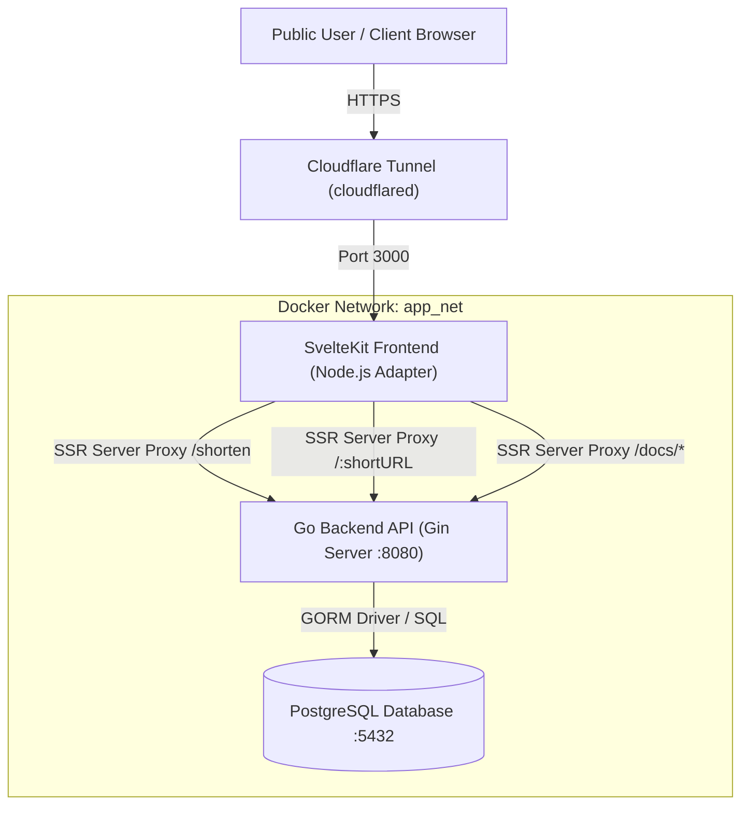
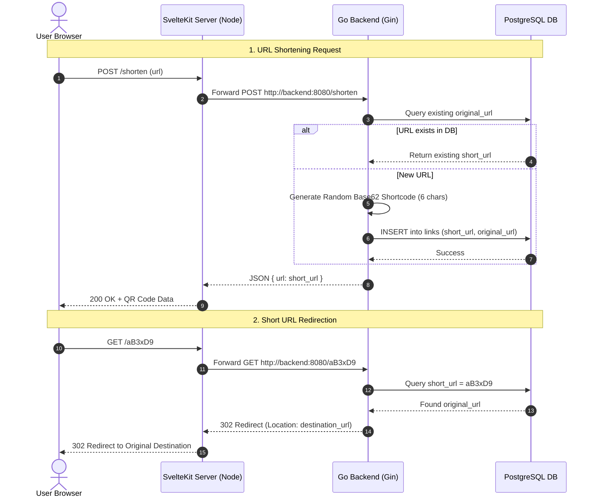

# Bukshort — Production-Ready URL Shortener

[](https://golang.org/)
[](https://kit.svelte.dev/)
[](https://www.postgresql.org/)
[](https://www.docker.com/)
[](https://github.com/features/actions)

**Bukshort** is a modern, high-performance, full-stack URL shortening web application. Built with a **Go (Gin framework)** REST API backend, a **SvelteKit** single-page application with SSR server proxying, **PostgreSQL** database persistence, and multi-architecture **Docker Compose** containerization designed for homelab ARM64 and cloud deployments.

---

## 📐 System Architecture

Bukshort is designed with a **single-domain reverse proxy architecture**. The SvelteKit SSR Node engine acts as the primary public gateway, forwarding API and redirection requests to the Go backend via Docker's internal container network (`app_net`).



---

## 🔄 Request Sequence Flow



---

## 🛠️ Key Engineering & Architectural Highlights

### 1. Zero-CORS & Single-Domain SSR Server Proxying
To prevent browser **Cross-Origin Resource Sharing (CORS)** and **Private Network Access (PNA loopback)** errors, SvelteKit server endpoints (`+server.ts`) proxy API calls (`/shorten`, `/:shortURL`, and `/docs/*any`) directly to `http://backend:8080` on Docker's internal network.
- **Result:** Users interact with a single domain (`https://short.jirapat.site`). No secondary API subdomains or open cross-origin policies are required.

### 2. High-Performance Go Backend & Collision Handling
- Built with **Gin** for minimal latency and **GORM** ORM targeting PostgreSQL.
- Shortcodes are generated using a Base62 character set (`a-z`, `A-Z`, `0-9`).
- Database constraints enforce unique indexes on both `original_url` and `short_url` with an automated retry loop to guarantee collision safety under high request concurrency.

### 3. Multi-Stage & Multi-Architecture Docker Containers
- Both **Backend** (`golang:1.22-alpine` -> `alpine:latest`) and **Frontend** (`node:20-alpine` with `pnpm`) use multi-stage Docker builds.
- Native support for **ARM64** (Raspberry Pi 4/5, Apple Silicon, SBCs, Proxmox ARM LXCs) and **AMD64** architectures.

### 4. Automated CI/CD & GHCR Publishing
- A custom **GitHub Actions workflow** (`.github/workflows/ci-cd.yml`) automatically builds and tests both Go backend and SvelteKit frontend on every pull request.
- Pushes to `main` use **Docker Buildx + QEMU** to publish multi-platform container images directly to **GitHub Container Registry (`ghcr.io`)**.

---

## 🧰 Tech Stack

| Layer | Technologies Used |
| :--- | :--- |
| **Frontend** | SvelteKit 2, Svelte 4, TypeScript, TailwindCSS, PostCSS, `@zerodevx/svelte-toast`, `qrcode` |
| **Backend** | Go 1.22, Gin Web Framework, GORM ORM, `swaggo/gin-swagger` (OpenAPI) |
| **Database** | PostgreSQL 14 Alpine |
| **DevOps & Infrastructure** | Docker, Docker Compose, GitHub Actions CI/CD, Cloudflare Tunnel (`cloudflared`) |

---

## 📡 API Specification

Interactive Swagger UI documentation is served automatically at `/docs/index.html`.

| Method | Endpoint | Description | Request Body / Params | Response |
| :--- | :--- | :--- | :--- | :--- |
| `POST` | `/shorten` | Shortens a long URL | `{ "url": "https://example.com" }` | `{ "url": "aB3xD9" }` |
| `GET` | `/:shortURL` | Redirects to original destination | Path param: `shortURL` | `302 Found` (Redirect) |
| `GET` | `/docs/*any` | Swagger API Documentation UI | None | `200 OK` (HTML/CSS/JS) |

---

## 🚀 Getting Started

### Prerequisites

- [Go](https://golang.org/) (v1.21+)
- [Node.js](https://nodejs.org/) (v20+) & [pnpm](https://pnpm.io/)
- [Docker](https://www.docker.com/) & Docker Compose (v2)

---

### Local Development Setup

1. **Clone the repository:**
   ```bash
   git clone https://github.com/Bukharney/Bukshort.git
   cd Bukshort
   ```

2. **Start Backend (Go):**
   ```bash
   cd backend
   cp .env.example .env # Set DB_URL and PORT
   go run main.go
   ```

3. **Start Frontend (SvelteKit):**
   ```bash
   cd frontend
   pnpm install
   pnpm dev
   ```

   Access SvelteKit dev server at `http://localhost:5173`.

---

### Production Deployment via Docker Compose

To deploy pre-built multi-architecture images directly from **GHCR**:

1. **Create environment file:**
   ```bash
   cp .env.example .env
   ```

2. **Run Production Containers:**
   ```bash
   docker compose -f docker-compose.prod.yml up -d
   ```

3. **Verify running services:**
   ```bash
   docker compose -f docker-compose.prod.yml ps
   ```

   - **Frontend App:** `http://localhost:3000`
   - **Backend API:** `http://localhost:8080` (Internal access)

---

## 🔒 Cloudflare Tunnel Setup (Homelab)

Bukshort runs securely behind Cloudflare Tunnel without exposing host ports to the internet:

1. **Create Tunnel** in [Cloudflare Zero Trust Dashboard](https://one.dash.cloudflare.com/).
2. **Add Public Hostname Ingress Rule:**
   - **Domain:** `short.jirapat.site`
   - **Service:** `HTTP` -> `localhost:3000` (or `frontend:3000`)
3. SvelteKit SSR will handle proxying API calls to backend internally.

---

## 📄 License

This project is licensed under the [MIT License](LICENSE).
